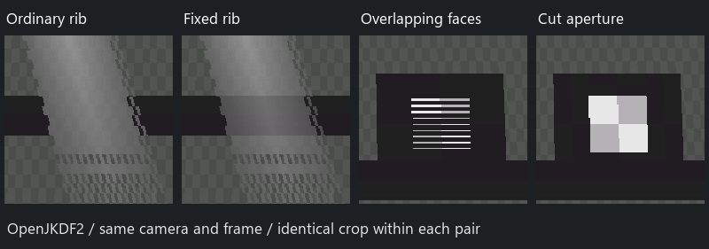

# Reviewing translucent geometry in JK

The [transparency gallery](../tools/engine-capture/fixtures/transparency-gallery/) is a small editable single-player JK episode. A diagonal band of light passes in front of a dark rib. A four-square badge sits in a panel beside it. The rib tests which surfaces remain visible through a translucent model. The badge tests what happens when an opaque face occupies the same plane as its backing.



These are crops of native 1280 × 720 OpenJKDF2 OpenGL frames using the 16-bit edition. Each pair shares its camera, frame number and crop. The stripe pattern and the shape of the fade can look different in retail software or Direct3D.

## Generate and open the gallery

From the RED source root, run the following with Python 3. Use new destination folders outside the checkout.

```sh
python tools/engine-capture/fixtures/transparency-gallery/make_project.py ../viewlab-work/revised-8 --edition 8
python tools/engine-capture/fixtures/transparency-gallery/make_project.py ../viewlab-work/revised-16 --edition 16
python tools/engine-capture/fixtures/transparency-gallery/make_project.py ../viewlab-work/rib-16 --edition 16 --control ordinary-rib
python tools/engine-capture/fixtures/transparency-gallery/make_project.py ../viewlab-work/crest-16 --edition 16 --control overlap-crest
python tools/engine-capture/fixtures/transparency-gallery/make_project.py ../viewlab-work/clear-16 --edition 16 --control no-shaft
python tools/engine-capture/verify_episode_pair.py ../viewlab-work/revised-8/viewlab.gob ../viewlab-work/revised-16/viewlab.gob
```

Substitute your own output root for `../viewlab-work`. Each output includes `viewlab.gob` and the same assets as loose editable files. Open `jkl/viewlab.jkl` in RED. The geometry uses RED's original Relay Bay rooms. Both editions share their JKL, models, grayscale colormap with a software blending table, and keyed shaft MAT. The 16-bit edition uses RGB565 for the three opaque materials. The example uses the standard JK file-format header and original fixture resources.

## Compare one change at a time

Use **Engine Capture** for a native frame. The camera used above was in sector **0**, position **(0, −0.44, 0.19)**, pitch **+8°**, yaw and roll **0°**, horizontal FOV **90°**, at rendered frame **8**. For two editions or edits, keep the camera, viewport, engine, renderer and frame the same within each comparison. Check these values in the returned records. If a reference painting is involved, also keep its full frame and mark two or three recognizable landmarks, such as the crossing and the badge center. Show detail crops alongside the original view. [Capture workflow](../tools/engine-capture/README.md)

| Compare with revised | What changed | What to look at |
|---|---|---|
| `no-shaft` | The shaft instance is absent. | Check the open wall and then the dark rib where the shaft crosses. The lit area should lift the underlying image. Look for a dark core, a conspicuous rectangular edge or a bright fringe at the lower tip. |
| `ordinary-rib` | The fixed, noncolliding rib loses its static-architecture Thing flag (`0x8`). Its mesh, position and material remain identical. | In the ordinary-rib capture the shaft obscures the crossing. In the revised capture you can trace the rib through it. Choose this classification for stationary architecture after checking the intended draw order. Moving or interactive objects have their own requirements. |
| `overlap-crest` | The badge and its backing have coplanar faces. The revised backing has an opening fitting the same badge at exactly the same depth. | Watch the four badge squares. On the overlapping control they break into stripes in the pictured frame. A lateral movement can also expose speckling. Use a real opening when a plaque fills a wall or panel. |

For a layered shaft spanning several sectors, keep the world-space edges and UV coordinates continuous where its models meet, and check each model against its owning sector with `thingModelSector`. Test silhouettes against the window ribs, the gallery below and an oblique view. Adjust the brightness of surviving fade texels as well as the number of transparent ones. A few bright pixels can persist after the shaft itself should have faded.

## Short movement pass in retail

Install one generated `viewlab.gob` in a local JK Episode folder and select **Transparency gallery** in New Game. Start with the 8-bit edition in the software renderer. Face the crossing, take a short sideways walk, reverse, and watch both the rib intersection and the badge. Repeat the same pass in 16-bit Direct3D with its matching GOB. Generate the same control in 8-bit by adding `--edition 8` to its build command in a new folder. Use one copy of the GOB per installation and swap editions between runs.

Record the GOB hash, executable, renderer and any compatibility wrapper with the footage. Keep angle and exposure consistent within each pair. The displayed frames above exercise the OpenJKDF2 controls. The retail passes are a separate check of blend tables, transparency ordering and movement in the intended renderer.
